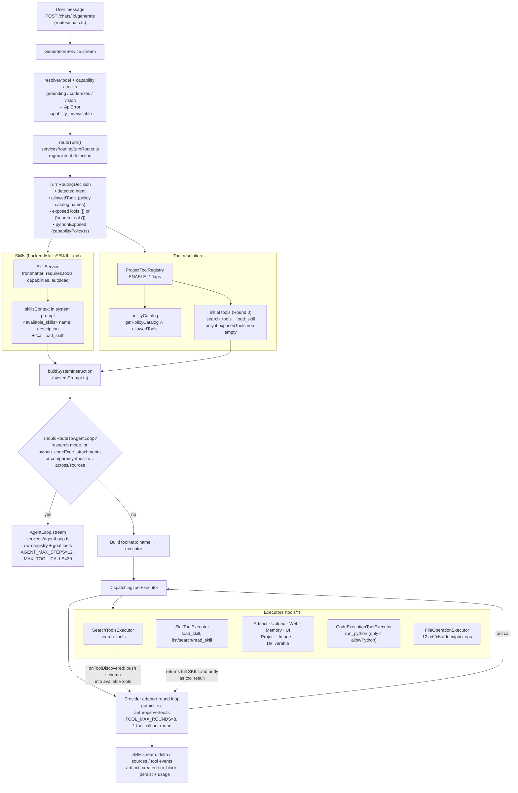

# Tools & skills architecture — as built

Traced from code on 2026-09-24 (`backend/src`). Describes what runs today, not the intended
design. Line refs are to `services/generation.ts` unless noted.

## One turn, start to finish

## Progressive disclosure, in one line

Round 0 the model sees only `search_tools` (+ `load_skill`). It calls `load_skill` for domain
rules, then `search_tools` to pull matching schemas from the policy catalog into the active tool
list, then calls the real tool on a later round.

## Tool inventory

| Group | Tools | Gate |
|---|---|---|
| Discovery | `search_tools` | `ENABLE_TOOL_USE` |
| Skills | `load_skill`, `list_skills`, `search_skills`, `read_skill` | `ENABLE_SKILLS` + ≥1 skill |
| Artifacts | `create_artifact`, `read_artifact`, `update_artifact` | tool use |
| Uploads | `read_uploaded_file` | tool use + attachments (router) |
| Deliverable | `generate_deliverable` | tool use (router always allows) |
| File ops | `inspectPdf`, `mergePdfFiles`, `splitPdfFile`, `inspectSpreadsheet`, `editSpreadsheetCells`, `combineWorkbooks`, `inspectDocxStructure`, `editDocxContent`, `appendDocxSection`, `inspectPptxStructure`, `reorderPptxSlides`, `editPptxSlideText` | tool use |
| Web | `web_search`, `web_fetch` | `ENABLE_WEB` |
| Memory | `search_memory`, `read_memory`, `update_memory`, `forget_memory` | `ENABLE_MEMORY` |
| Image | `generate_image` | `ENABLE_IMAGE_GENERATION` |
| Project | `search_project_files`, `read_project_file` | project attached |
| Code | `run_python` | `ENABLE_RUN_PYTHON` + sandbox + `evaluateRunPythonPolicy` |
| UI | `render_ui` | `ENABLE_GENERATIVE_UI` — see gaps |
| Goals (AgentLoop only) | `get_goal`, `update_goal`, `get_context_remaining` | `ENABLE_AGENT_LOOP` + active goal |

Built-in skills: `artifact-design`, `dashboard-design`, `data-analysis`, `data-quality`,
`dataviz`, `docx`, `pdf`, `pptx`, `python-sandbox-patterns`, `research-deep-dive`,
`skill-creator`, `xlsx`.

## Gaps found while tracing

1. **`render_ui` is unreachable in the chat path.** `computeAllowedTools` never adds it, and the
   policy catalog is filtered by `allowedTools`, so `search_tools` can never surface it.
2. **Skills are advertised when `load_skill` is not sent.** On `EXPLANATION` and `ORDINARY_CHAT`
   intents `exposedTools` is `[]`, so no tools go to the provider — but `skillsContext` still
   tells the model to call `load_skill`.
3. **`evaluateDeliverablePolicy` is dead.** `shouldExposeGenerateDeliverable` is imported but
   unused; `allowDeliverable` is always true because the router always allows
   `generate_deliverable`.
4. **"Summarize this PDF" gets no tools.** It matches `EXPLANATION`, so `read_uploaded_file` is
   not reachable; only inlined `attachmentText` is available.
5. **Agent-loop routing is duplicated.** `isAgentMode` and `shouldRouteToAgentLoop` repeat the
   same heuristic separately and can drift.
