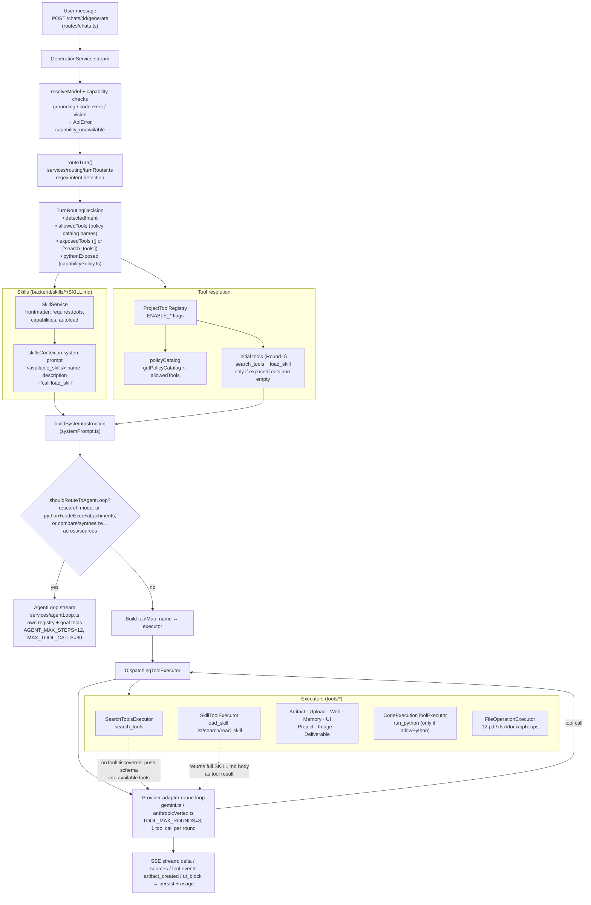

# Tools & skills architecture — as built

Traced from code on 2026-09-24 (`backend/src`). Describes what runs today, not the intended
design. Line refs are to `services/generation.ts` unless noted.

## One turn, start to finish

## Progressive disclosure, in one line

Round 0 the model sees only `search_tools` (+ `load_skill`). It calls `load_skill` for domain
rules, then `search_tools` to pull matching schemas from the policy catalog into the active tool
list, then calls the real tool on a later round.

## Tool inventory

| Group | Tools | Gate |
|---|---|---|
| Discovery | `search_tools` | `ENABLE_TOOL_USE` |
| Skills | `load_skill`, `list_skills`, `search_skills`, `read_skill` | `ENABLE_SKILLS` + ≥1 skill |
| Artifacts | `create_artifact`, `read_artifact`, `update_artifact` | tool use |
| Uploads | `read_uploaded_file` | tool use + attachments (router) |
| Deliverable | `generate_deliverable` | tool use (router always allows) |
| File ops | `inspectPdf`, `mergePdfFiles`, `splitPdfFile`, `inspectSpreadsheet`, `editSpreadsheetCells`, `combineWorkbooks`, `inspectDocxStructure`, `editDocxContent`, `appendDocxSection`, `inspectPptxStructure`, `reorderPptxSlides`, `editPptxSlideText` | tool use |
| Web | `web_search`, `web_fetch` | `ENABLE_WEB` |
| Memory | `search_memory`, `read_memory`, `update_memory`, `forget_memory` | `ENABLE_MEMORY` |
| Image | `generate_image` | `ENABLE_IMAGE_GENERATION` |
| Project | `search_project_files`, `read_project_file` | project attached |
| Code | `run_python` | `ENABLE_RUN_PYTHON` + sandbox + `evaluateRunPythonPolicy` |
| UI | `render_ui` | `ENABLE_GENERATIVE_UI` — see gaps |
| Goals (AgentLoop only) | `get_goal`, `update_goal`, `get_context_remaining` | `ENABLE_AGENT_LOOP` + active goal |

Built-in skills: `artifact-design`, `dashboard-design`, `data-analysis`, `data-quality`,
`dataviz`, `docx`, `pdf`, `pptx`, `python-sandbox-patterns`, `research-deep-dive`,
`skill-creator`, `xlsx`.

## Gaps against Claude's reference architecture

Reference: Claude's tool-use pipeline as documented in the `claude-api` skill
(`shared/agent-design.md`, `shared/platform-availability.md`): skill descriptions always in
context, tool search always present with the rest deferred, one model-driven loop, parallel tool
calls, gates decide only *allowed*. Vertex constraint: tool search is available; Agent Skills,
code execution, web fetch and programmatic tool calling are not — so a custom skill registry and
sandbox are correct, not gaps.

Verified by running `routeTurn()` with a PDF attached and `runPythonEnabled: true`:
"Count every transaction exactly and classify them" → `ORDINARY_CHAT`, exposed `[]`, python
`false`; "Summarize this PDF" → `EXPLANATION`, `[]`, `false`.

### Router acting as a second brain (blocks the locked flow)

| # | Gap | Where |
|---|---|---|
| G1 ✅ Phase 1 | `EXPLANATION` / `ORDINARY_CHAT` return `exposedTools: []`, so the model gets no `load_skill` and no `search_tools` | `services/routing/turnRouter.ts` (EXPLANATION and default branches), `services/generation.ts` `availableTools` |
| G2 ✅ Phase 1 | `run_python` is removed from the policy catalog by prompt-text regex; a non-tabular PDF never qualifies, so `search_tools` can never find it | `tools/capabilityPolicy.ts` `evaluateRunPythonPolicy`, `turnRouter.ts` `computeAllowedTools` |
| G3 ✅ Phase 1 | `render_ui` is never added to `allowedTools`, so it is undiscoverable in the chat path | `turnRouter.ts` `computeAllowedTools` |
| G4 | Chat path and AgentLoop gate differently: chat always allows `generate_deliverable`; AgentLoop uses `shouldExposeGenerateDeliverable` and calls `shouldExposeRunPython` without MIME types. Same prompt, different tools per path | `generation.ts` vs `services/agentLoop.ts` |
| G5 | Chat vs AgentLoop is chosen by keyword regex, and that regex is written twice (`isAgentMode`, `shouldRouteToAgentLoop`) | `generation.ts` |

### Context

| # | Gap | Where |
|---|---|---|
| G6 ✅ Phase 2 | `hasAttachments` is current-turn only. A follow-up about a file attached earlier gets no `read_uploaded_file` in the catalog | `routes/chats.ts` (`attachmentIds.length > 0`) |

### Skills

| # | Gap | Where |
|---|---|---|
| G7 ✅ Phase 1 | `<available_skills>` + "call load_skill" is always in the system prompt, even on turns where `load_skill` is not sent | `generation.ts` skillsContext |
| G8 | `selectedSkills` is always `[]`, so the preload branch is dead; AgentLoop hard-codes one autoload by name | `turnRouter.ts`, `agentLoop.ts` |

### Discovery and the loop

| # | Gap | Where |
|---|---|---|
| G9 | Discovered tools are appended to `tools`, which renders before `system` — every discovery (and the tool-less final round) invalidates the Claude prompt cache. Claude's native tool search, available on Vertex, appends without breaking the prefix | `generation.ts` onToolDiscovered, `providers/anthropicVertex.ts` final-round `effectiveTools` |
| G10 | One tool call per round (`disable_parallel_tool_use: true`, extras get a deferred error). Claude's guidance: splitting results trains the model to stop making parallel calls | `providers/toolLoopPolicy.ts`, `anthropicVertex.ts`, `gemini.ts` |
| G11 | `TOOL_MAX_ROUNDS=8` in chat; load_skill + search_tools + work + QA + repair each cost a round | `config.ts` |
| G12 | A failed call is blocked from retry with identical input and the model is told to stop and answer — a transient failure cannot be retried | `anthropicVertex.ts` failedToolCalls guard |
| G13 ✅ Phase 3 | No handling of `stop_reason: "refusal"` (Opus 5 / Sonnet 5 can return it); it ends as an ordinary finish — Invariant 1 | `anthropicVertex.ts` finishReason |

### QA

| # | Gap | Where |
|---|---|---|
| G14 ✅ Phase 3 | Visual QA never runs vision: no caller passes `visionProvider`, so it falls back to a PNG magic-header check and reports pass. The locked architecture's "vision checks layout" does not happen | `services/qa/visualQaEngine.ts`, callers in `tools/fileOperationExecutor.ts`, `tools/codeExecutionExecutor.ts` |

### Provider file adapters (locked layer 4)

Verified by running `buildAnthropicMessages` / `buildGeminiContents` with an `.xlsx` whose
extracted text carries a marker, plus an earlier-turn PDF with no bytes hydrated.

| # | Gap | Where |
|---|---|---|
| G15 ✅ Phase 2 | An earlier-turn PDF left out of the 12 MB history byte budget reaches the model empty: Claude gets a `document` block with `data: ""`, Gemini gets `[Empty or unreadable document]`. PDFs are never text-extracted at upload, so there is no fallback, and no machine-readable reason is surfaced (Invariant 1). With G6 the model cannot recover it via `read_uploaded_file` either | `services/generation.ts` `hydrateHistoryAttachments`, `providers/anthropicVertex.ts` `attachmentBlocks`, `providers/gemini.ts` `attachmentParts`, `routes/files.ts` `isNativelyViewable` |
| G26 ✅ Phase 2 | Attachments never reach the sandbox `input/`. Materialisation in `generation.ts` and `agentLoop.ts` checks `att.name`, but `routes/chats.ts` builds attachments with `filename` only (`AttachmentBlock` has both fields). So `run_python` gets an empty `input/` even after it becomes discoverable | `services/generation.ts` (run, `if (att.name)`), `services/agentLoop.ts` (same), `providers/types.ts` `AttachmentBlock` |
| G27 ✅ Phase 2 | Found while fixing G16: `loadHistory` excluded only the assistant row, so the current user message (with its attachments) was sent both as the last history turn and as the current turn. Every prompt and every current attachment, PDF bytes included, went to the provider twice | `services/generation.ts` `loadHistory` |
| G16 ✅ Phase 2 | Office extracted text is sent twice, on both providers (marker count 2): once appended to the prompt as `attachmentText`, again as a document block / part from `extractedText`. History turns do the same (appended to turn text + kept on the attachment). Up to 200k chars per file, doubled | `routes/chats.ts` attachmentText, `services/generation.ts` effectivePrompt and history mapping |
| G17 ✅ Phase 2 | If Office extraction failed (`extractedText` null), Claude decodes the raw ZIP bytes as UTF-8 text and Gemini sends DOCX/XLSX bytes as `inlineData`, a MIME type it does not accept. Code-read only, not provider-tested | `attachmentBlocks`, `attachmentParts` fallbacks |
| G18 ✅ Phase 2 | Provider limits are found by failure, not checked up front: PDF page limits (Claude 600, or 100 on 200k-context models) are not checked; the 5 MB image limit is detected by matching provider error prose | `services/generation.ts` error mapping |

Matches Claude's contract: image MIME allowlist (png/jpeg/webp/gif) equals Claude's; media before
text in the user turn; 20 MB upload cap is under Claude's 32 MB request limit.

### Execution runtime (locked layer 8)

Code-read against `tools/execution/executionRuntime.ts`, `tools/sandbox/*`, `sandbox/Dockerfile`,
`container.ts`, ADR-0005 and `docs/deploy/cloud-run-sandbox-setup.md`. Not live-tested.

| # | Gap | Where |
|---|---|---|
| G19 | Office rendering cannot work through the Cloud Run sandbox. Visual QA writes the file to `temp/` and runs `soffice` with `cwd: temp/`; the client stages only `<cwd>/input/` (which does not exist), and the converted PDF is written inside the job container and never returned. Office visual QA therefore ends in "produced no PDF output" whenever the Cloud Run engine is in use | `services/qa/visualQaEngine.ts` render, `tools/sandbox/cloudRunSandboxClient.ts` staging |
| G20 ◐ Phase 3 (permission split done; rest in Phase 6) | Trusted CLI capabilities (LibreOffice, pdftoppm, pandoc) exist only through the `run_python` sandbox: host CLI is blocked in production and Cloud Run has no Docker. With `ENABLE_RUN_PYTHON` off, they are all off, so "trusted tools" depend on the arbitrary-code flag | `executionRuntime.ts` `executeControlledCli` |
| G21 | The sandbox has open outbound network (ADR-0005). **Decided 2026-09-24: no general egress** ([ADR-0007](decisions/0007-sandbox-no-general-egress.md)); open until the infrastructure change lands | ADR-0005 "Runtime image" |
| G22 | Silent drops: without a staging bucket, input files over 2 MB are skipped with no message; signed-URL and staging failures are swallowed as "non-blocking", so outputs can go missing without a reason (Invariant 1) | `cloudRunSandboxClient.ts` input staging and output URLs |
| G23 | The job's limits in the setup doc are 1 CPU, 512 Mi, `--task-timeout=15s`. The CLI bridge asks for 30 s, and LibreOffice or pandas on a long statement can easily exceed 15 s and 512 Mi | setup doc, `executeControlledCli` |
| G24 ✅ Phase 3 (`pdf/scripts/normalize_table_rows.py`, `analyze_table_rows.py`) | Skill scripts and references are unreachable: no skill ships any file besides `SKILL.md`, and nothing calls `executeTrustedSkillScript`. "references/scripts only when required" from the locked design does not exist yet | `backend/skills/*`, `executionRuntime.ts` |
| G25 | The local Docker path builds an `sh -c` string by joining args; the guard misses newlines and quotes. Callers pass fixed filenames today, so this is latent, but it becomes an injection path if a model-supplied argument ever reaches it. Dev only | `executeControlledCli` Docker branch |

Matches the locked design: non-root `sandbox` user, a fresh container per run, per-run
`input/ output/ temp/` with cleanup in `finally`, path-traversal checks on inputs and outputs,
host CLI fail-closed in production, the process sandbox refused in production, an orchestration
timeout, a concurrency semaphore, and stdout/stderr caps.
